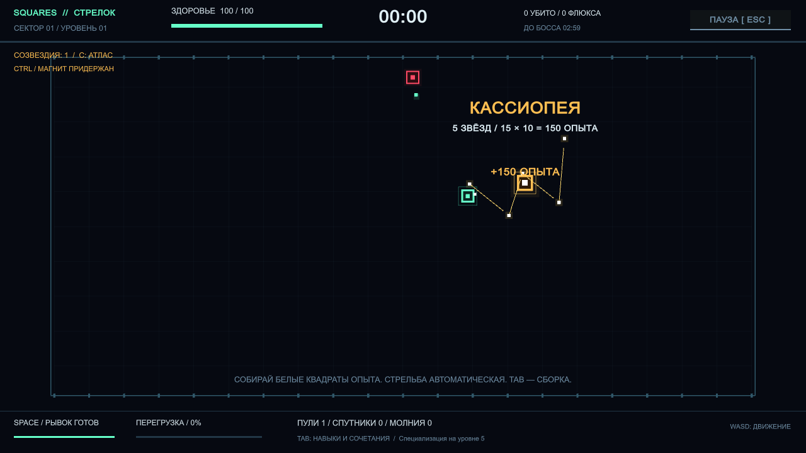
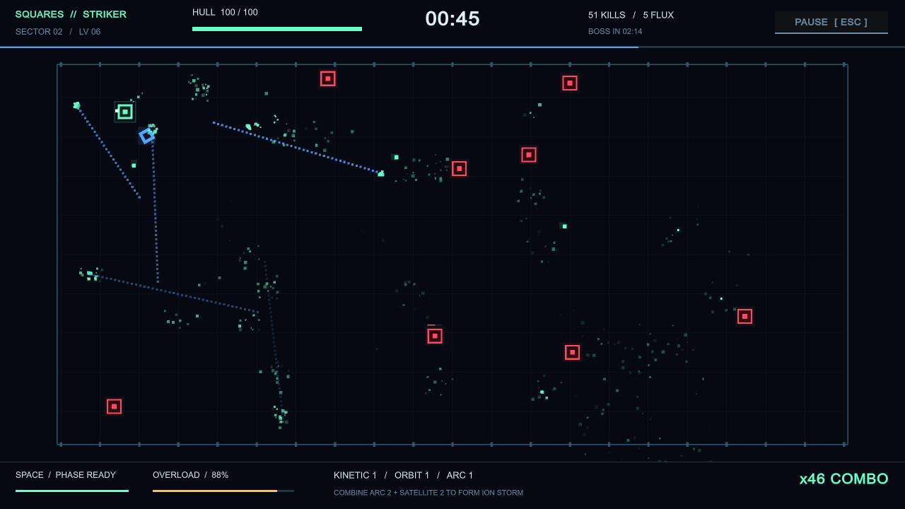
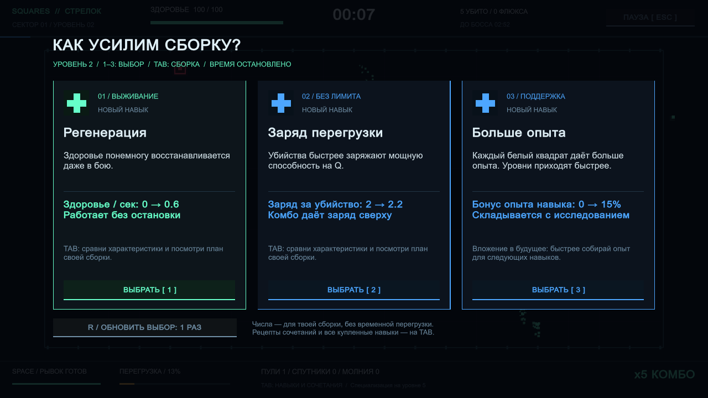

# SQUARES // OVERLOAD

A Unity 6 arena roguelite about building a square reactor under pressure.
No art packs, round particles, or external gameplay dependencies.

**v0.3 — Созвездия из опыта.** Если белые точки складываются в похожую фигуру известного
созвездия, загораются линии и название, фигура пролетает за экран, а точки заменяются одним
золотым сгустком с **10 × их суммарным опытом**. Есть шесть основных рисунков с допуском
по положению звёзд. **C** — атлас, **CTRL** — временно не притягивать опыт.





Version 0.2: Russian skill cards show **before → after**, with descriptions and build hints.
New skills: explosive bullets, slowing bullets, and dash impact. At level five choose one
specialization with an advantage and a drawback. TAB shows your complete build and three
synergy recipes; each run includes one free upgrade reroll.



## Play

Run `Builds/Windows/Squares.exe`, or open this directory in Unity **6000.3.26f1**,
open `Assets/Scenes/Arena.unity`, and press Play.

| Input | Action |
|---|---|
| WASD / arrow keys | Move |
| Space / Shift | Dash through danger |
| Q | Activate OVERLOAD when charged |
| 1 / 2 / 3 or click | Choose a module |
| R during a draft | Reroll once per run |
| Tab | Pause and inspect skills, stats, and synergy recipes |
| C | Pause and open the constellation atlas |
| Hold Ctrl | Leave XP on the field instead of attracting/collecting it |
| Esc | Pause / resume |
| F11 | Toggle fullscreen |

Weapons fire automatically at nearby enemies. Collect white data squares to level up.
Combine projectiles, satellites, and lightning; each has a different scaling path.
Bosses arrive every three minutes. Defeating the first boss banks a milestone reward;
continue into increasingly dangerous sectors. After a run, spend flux on reactor unlocks
and persistent research. Saves are portable in the ignored `Saves/` directory alongside
the build (or in the project root in the Editor).

## Development

Specification → implementation → simulation checks → build → state update.
See [design](docs/game-design.md), [first specification](docs/specs/001-playable-foundation.md),
and [current state](docs/current-state.md).

```powershell
powershell.exe -NoProfile -ExecutionPolicy Bypass -File ./tools/Build.ps1
powershell.exe -NoProfile -ExecutionPolicy Bypass -File ./tools/Smoke.ps1
# Explicit visible preview, including menu/draft/pause/results screenshots:
powershell.exe -NoProfile -ExecutionPolicy Bypass -File ./tools/Smoke.ps1 -Visible
```

`Build.ps1` imports the project, generates the boot scene, runs deterministic simulation
checks, and builds the Windows player. `Smoke.ps1` runs the actual player with an
automated pilot and checks its structured result. Hidden runs cannot validate pixels;
use `-Visible` for screenshots. Neither replaces human playtesting.

The simulation runs at 60 fixed ticks per second with its own seeded random generator.
Commands, entity IDs, and progression live in a Unity-independent assembly. Rendering,
input, audio, and save files are adapters. Multiplayer transport, rollback, and lockstep
are not implemented.
